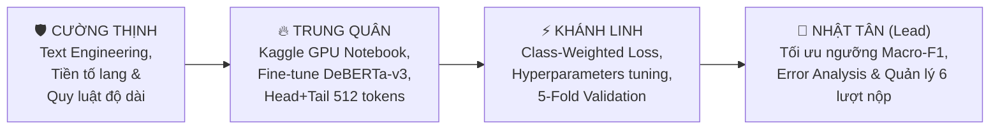

# 🎯 BẢNG PHÂN CÔNG NHIỆM VỤ & CHIẾN THUẬT — RMIT HACKATHON 2026 (CHALLENGE 1)

> [!IMPORTANT]
> **CHIẾN THUẬT ĐÃ CHỐT: THUẦN 1 MODEL TRÊN KAGGLE (END-TO-END REPRODUCIBILITY)**
> - Nhóm tập trung dồn toàn lực tối ưu cho **DUY NHẤT 1 mô hình nòng cốt** được BTC cấp phép: **`protectai/deberta-v3-base-prompt-injection-v2`** (chuyên gia bảo mật đã pretrain sẵn cho bài toán Prompt Injection).
> - Toàn bộ quy trình từ tiền xử lý, huấn luyện 5-Fold, tối ưu ngưỡng Macro-F1 đến xuất file `submission.csv` chạy khép kín trong **Kaggle Notebook chính thức**, đảm bảo **100% đúng luật** (*"You must build your solution on one of the approved models"*) và **100% tái lập được (Reproducible)** khi giám khảo bấm "Run All".
> - Mô hình Baseline TF-IDF (OOF Macro-F1 = `0.9316`) đóng vai trò mốc an toàn (Safety Net) và kiểm chứng pipeline.

---

## 📊 1. Hiện Trạng & Tiến Trình Dự Án

| Thành phần | Trạng thái | Đường dẫn file trong Repo | Ghi chú quan trọng |
| :--- | :---: | :--- | :--- |
| **Dữ liệu gốc (`train`, `test`)** | ✅ Sẵn sàng | `data/raw/train.csv` (14,000 dòng)<br>`data/raw/test.csv` (6,000 dòng) | Chỉ đọc (`READ-ONLY`), không có giá trị `NaN`. |
| **Bộ chia 5-Fold dùng chung** | ✅ Đã khóa | `data/processed/folds.csv` | **Cả 4 thành viên dùng chung 100%** qua `load_folds(train_df)`. |
| **Baseline Mẫu (TF-IDF + Linear)** | ✅ Đã chạy | `submissions/baseline_tfidf_blend.csv`<br>`data/processed/oof_tfidf_svc.npy` | **OOF Macro-F1 = `0.9316`** (Dùng làm mốc tham chiếu nội bộ & Lượt nộp kiểm tra kết nối #1). |
| **Official Kaggle Notebook** | 🚀 Đang triển khai | `RMIT_SGS_<team>_C1` trên Kaggle GPU | Chạy thuần `deberta-v3`, xuất trực tiếp `submission.csv`. |

---

## 💎 2. Phát Hiện "Mỏ Vàng" Từ Dữ Liệu Thật — Cả Team Cần Nắm Vững

1. **Phân bố Ngôn ngữ (`language`) & Nhãn (`label`) khớp 100% giữa Train và Test:**
   - **Ngôn ngữ:** Tiếng Bồ Đào Nha `pt` (**45%**), Tiếng Pháp `fr` (**25%**), Tiếng Ý `it` (**20%**), Tiếng Anh `en` (**10%**).
   - **Tỷ lệ 3 lớp:**
     - `BENIGN`: **62.0%** (`8,680` mẫu train)
     - `JAILBREAK`: **31.0%** (`4,340` mẫu train)
     - `PROMPT_INJECTION`: **7.0%** (`980` mẫu train — **chiếm trọn 1/3 tổng điểm Macro-F1!**)
2. **Quy luật Độ dài Văn bản (`char_len`) cực kỳ đắt giá:**
   - **`JAILBREAK`:** Độ dài nằm gọn trong khoảng **`[112, 3752]` ký tự** (trung vị `565` ký tự). **Không có bất kỳ mẫu `JAILBREAK` nào dưới 112 ký tự hoặc trên 3,752 ký tự!**
   - **`PROMPT_INJECTION`:** Ngắn gọn, trung vị chỉ **`99` ký tự** (75% mẫu dưới `263` ký tự).
   - **`BENIGN`:** Trải dài từ `10` đến **`18,550` ký tự** (100% mẫu dài trên `5,128` ký tự là `BENIGN`).
3. **Điểm nghẽn lỗi sai thực tế:**
   - **80% tổng số lỗi** là nhầm lẫn giữa **`BENIGN` $\leftrightarrow$ `JAILBREAK` trong tiếng Bồ Đào Nha (`pt`)**.
   - **18% tổng số lỗi** là nhầm lẫn giữa **`BENIGN` $\leftrightarrow$ `PROMPT_INJECTION` trong `en, it, fr`**.

---

## 👥 3. Phân Công Nhiệm Vụ Chi Tiết (Single-Model Kaggle Focus)



---

### 👑 1. Nhật Tân — Team Lead, Kaggle Pipeline & Quota Master
**Trách nhiệm chính:** Quản trị chiến lược, điều phối notebook chính thức, tối ưu hóa ngưỡng Macro-F1 và bảo vệ quota 6 lần nộp.

- [ ] **Task 1 (Quản lý Quota 6 lần nộp):** 
  - Sử dụng **Lần nộp #1** bằng file [`submissions/baseline_tfidf_blend.csv`](file:///d:/Code/rmit-hackathon-2026/submissions/baseline_tfidf_blend.csv) (OOF = `0.9316`) để thông chốt pipeline và lấy điểm mốc ban đầu trên Leaderboard.
  - **Giữ chặt 5 lượt nộp còn lại** cho các phiên bản DeBERTa-v3 nâng cấp.
- [ ] **Task 2 (Tích hợp Tối ưu Ngưỡng Macro-F1 vào Notebook):**
  - Đóng gói logic `optimize_class_multipliers()` từ `src/blend.py` thành 1 cell hàm gọn nhẹ ở cuối Kaggle Notebook của Quân.
  - Sau khi DeBERTa xuất xác suất `(N_test, 3)`, tự động nhân hệ số $(m_0, m_1, m_2)$ để ép tăng độ nhạy cho lớp 7% `PROMPT_INJECTION` trước khi dịch ra nhãn chữ `BENIGN, JAILBREAK, PROMPT_INJECTION`.
- [ ] **Task 3 (Phân tích lỗi OOF & Điều phối cải tiến):**
  - Xem xét các mẫu DeBERTa đoán sai trên 5-Fold, phân loại theo ngôn ngữ (`pt` vs `en, fr, it`) và chỉ đạo Cường Thịnh nắn lại text đầu vào.
- [ ] **Task 4 (Kiểm duyệt & Nộp bài):**
  - Chạy `validate_submission()` kiểm tra file output của Notebook (đúng 6,000 dòng, cột `id, label`, không có `NaN`) rồi trực tiếp bấm Submit trên Kaggle.

---

### 🔥 2. Trung Quân — Kaggle GPU & Model Training Lead
**Trách nhiệm chính:** Xây dựng và vận hành Kaggle Notebook chính thức, biến DeBERTa-v3 thành vũ khí ghi điểm cao nhất.

- [ ] **Task 1 (Khởi tạo Notebook chuẩn BTC):**
  - Tạo Notebook trên Kaggle GPU (T4 x2), đặt tên đúng chuẩn quy định: `RMIT_SGS_<team>_C1`.
  - Khai báo model ở dòng đầu tiên của Notebook: `# Model: protectai/deberta-v3-base-prompt-injection-v2`.
  - Import tập dữ liệu cuộc thi và upload `data/processed/folds.csv` để giữ đúng 5-Fold của nhóm.
- [ ] **Task 2 (Cài đặt Pipeline DeBERTa-v3 với AutoModelForSequenceClassification):**
  - Cấu hình mô hình `num_labels=3`, ánh xạ nhãn: `0: BENIGN, 1: JAILBREAK, 2: PROMPT_INJECTION`.
  - Bật FP16 (Mixed Precision) để tiết kiệm VRAM và tăng tốc độ train x2 lần.
- [ ] **Task 3 (Kỹ thuật Head + Tail Token Truncation):**
  - Vì prompt dài tới 18,550 ký tự trong khi transformer nhận tối đa 512 tokens: Cắt lấy **256 token đầu + 256 token cuối** (không cắt cụt đuôi vì lệnh tấn công thường ẩn ở cuối câu).
- [ ] **Task 4 (Inference & Xuất submission.csv khép kín):**
  - Dự đoán trên `test.csv` (6,000 dòng), áp dụng hàm tối ưu ngưỡng của Nhật Tân và lưu thẳng ra file `/kaggle/working/submission.csv`.
  - Đảm bảo khi bấm **"Run All" / "Save & Run All (Commit)"**, notebook chạy mượt mà từ đầu đến cuối không lỗi.

---

### 🛡️ 3. Cường Thịnh — Prompt Formatting & Text Engineering Specialist
**Trách nhiệm chính:** Chuẩn bị định dạng text đầu vào tối ưu nhất cho DeBERTa đọc hiểu, giải quyết triệt để 80% lỗi ở tiếng Bồ Đào Nha.

- [ ] **Task 1 (Format Tiền tố Ngôn ngữ):**
  - Thiết kế hàm format text đầu vào cho Transformer: `f"lang: {language} | {clean_text}"`.
  - Đảm bảo Transformer nhận biết tức thì văn cảnh ngôn ngữ để phân biệt ngữ nghĩa đặc thù.
- [ ] **Task 2 (Giải quyết điểm nghẽn 80% lỗi ở Tiếng Bồ Đào Nha `pt`):**
  - Phân tích sự khác biệt giữa *Contrastive Benign* (mượn vỏ bọc nhập vai giả định nhưng hỏi việc an toàn) và *Subtle Jailbreak* (giả bộ nghiên cứu lịch sử để hỏi cách chế vũ khí/mã độc).
  - Tích hợp các chỉ báo ngữ cảnh vào text để mô hình chú ý vào "nội dung yêu cầu cốt lõi" thay vì bị đánh lừa bởi vỏ bọc nhập vai.
- [ ] **Task 3 (Đặc trưng Ngưỡng Độ Dài Vàng):**
  - Khai thác quy luật độ dài:
    - Nếu `char_len < 112` hoặc `char_len > 3752` $\rightarrow$ Thêm tín hiệu loại trừ nhãn `JAILBREAK`.
    - Nếu `char_len > 5128` $\rightarrow$ Thêm tín hiệu chỉ báo 100% là `BENIGN`.
- [ ] **Task 4 (Đảm bảo an toàn ký tự Unicode):**
  - Đồng bộ hàm `clean_text_safety()` vào notebook của Quân, tuyệt đối không dùng regex làm mất dấu diacritics tiếng Romance (`é, è, ê, ç, ã, õ, á, í...`) hay mất delimiter Markdown/XML (` ``` `, `<|...|>`).

---

### ⚡ 4. Khánh Linh — Hyperparameters, Loss Tuning & Validation Specialist
**Trách nhiệm chính:** Cấu hình hàm mất mát, tối ưu siêu tham số và kiểm soát độ hội tụ của DeBERTa trên 5-Fold.

- [ ] **Task 1 (Cấu hình Class-Weighted Loss / Focal Loss giải bài toán 62-31-7):**
  - Thiết lập trọng số phạt trong hàm mất mát PyTorch để trừng phạt nặng khi đoán sai lớp `PROMPT_INJECTION` (7%):
    ```python
    weights = torch.tensor([1.0, 2.0, 8.8]).to(device)
    criterion = torch.nn.CrossEntropyLoss(weight=weights)
    ```
- [ ] **Task 2 (Tinh chỉnh Siêu tham số Huấn luyện - Hyperparameters):**
  - Learning Rate: Khởi đầu ở `1.5e-5` – `2e-5` với `get_cosine_schedule_with_warmup` (warmup 10% số bước).
  - Batch size: `16` (hoặc `8` kèm `gradient_accumulation_steps=2` để đạt batch size hiệu dụng `16-32`).
  - Epochs: `3` – `4` epochs mỗi fold (DeBERTa pretrained hội tụ rất nhanh, tránh train quá nhiều gây overfit).
  - Weight decay: `0.01`, Dropout: `0.1`.
- [ ] **Task 3 (Đánh giá Validation & Chọn Checkpoint tối ưu):**
  - Theo dõi **OOF Macro-F1** qua từng epoch trên 5-Fold chung `folds.csv`.
  - Lưu checkpoint có điểm Macro-F1 cao nhất để đưa vào bước dự đoán cuối cùng, đảm bảo mô hình tổng quát hóa tốt nhất trên tập Test.
- [ ] **Task 4 (Kế hoạch dự phòng Backbone thứ 2):**
  - Chuẩn bị sẵn cấu hình cho model dự phòng `FacebookAI/xlm-roberta-base` phòng trường hợp cần đối chứng điểm số với DeBERTa.

---

## 📅 4. Kế Hoạch 6 Lần Nộp Bài (Kaggle Quota Distribution)

| Lần nộp | Thời điểm dự kiến | Nội dung bài nộp | Mục tiêu điểm Macro-F1 | Người phụ trách duyệt |
| :---: | :---: | :--- | :---: | :---: |
| **#1** | Đầu buổi sáng | `baseline_tfidf_blend.csv` (Đã có sẵn) | **`0.9316`** (Xác nhận đường truyền) | Nhật Tân |
| **#2** | Giữa buổi sáng | DeBERTa-v3 baseline đầu tiên trên Kaggle | **`0.9500+`** (Kiểm tra sức mạnh Deep Learning) | Nhật Tân / Trung Quân |
| **#3** | Đầu buổi chiều | DeBERTa-v3 + Class Weights + Ghép `lang:` | **`0.9600+`** (Tối ưu lớp 7% & đa ngôn ngữ) | Cả nhóm |
| **#4** | Giữa buổi chiều | DeBERTa-v3 + Head+Tail Truncation + Độ dài vàng | **`0.9650+`** (Xử lý prompt dài & ranh giới độ dài) | Cả nhóm |
| **#5** | 4:30 PM | Phiên bản hoàn thiện nhất (Best Checkpoint + Threshold Tuning) | **`0.9700+`** (Chốt điểm số tranh giải) | Cả nhóm |
| **#6** | 5:30 PM | **LƯỢT DỰ PHÒNG KHẨN CẤP** (Chỉ dùng khi có cải tiến phút chót) | Top 1 Leaderboard | Nhật Tân |

---

## 🤝 5. Quy Chuẩn Nộp Bài Khép Kín (Checklist cuối cùng)

Trước khi bấm nút Submit trên Kaggle hoặc nộp link cho BTC:
1. [ ] Notebook trên Kaggle đặt tên đúng: `RMIT_SGS_<team>_C1`.
2. [ ] Dòng đầu tiên trong Notebook ghi rõ: `# Model: protectai/deberta-v3-base-prompt-injection-v2`.
3. [ ] Đã bấm **"Save & Run All (Commit)"** và chạy thành công từ đầu đến cuối ra file `submission.csv`.
4. [ ] File `submission.csv` có đúng **6,000 dòng**, 2 cột `id, label`, nhãn chỉ thuộc `{'BENIGN', 'JAILBREAK', 'PROMPT_INJECTION'}`.
5. [ ] Để Notebook ở chế độ **Private** trong suốt thời gian thi, chỉ share quyền / lấy link khi đến giờ nộp bài chính thức (5:00 - 6:00 PM).
