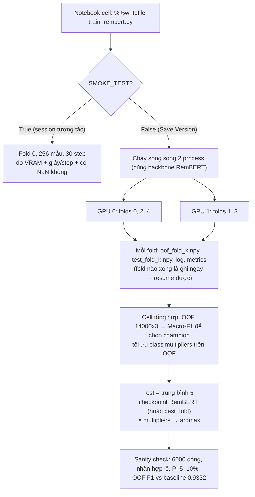

# Plan: Train `google/rembert` 5-Fold qua đêm trên Kaggle (T4 x2) — Single-Model

> [!NOTE]
> **Tài liệu tham khảo bắt buộc cho toàn đội:** Xem chi tiết các phát hiện thực tế từ 2 lần submit trước (DeBERTa vs XLM-RoBERTa-large) tại [lessons_learned_and_model_guidelines.md](file:///d:/Code/rmit-hackathon-2026/docs/lessons_learned_and_model_guidelines.md).

## Mục tiêu

Train **RemBERT** (32 layers, hidden 1152, ~575M params) trên Kaggle tối nay như **1 ứng viên "Single Champion Model"**. Chỉ dùng **1 backbone duy nhất** (`google/rembert`) — **không blend/stack với bất kỳ model nào khác**.

Sáng mai sẽ có:

1. `submission.csv` — dự đoán test chỉ từ RemBERT, đã qua sanity check, sẵn sàng cho Nhật Tân duyệt.
2. `metrics.json` — **OOF Macro-F1 trên 5-fold chung** (tổng / từng fold / từng ngôn ngữ / từng lớp) → để **so sánh công bằng** với các ứng viên nhanh hơn của team và **chọn 1 model vô địch**.
3. `oof_probs_rembert.npy`, `test_probs_rembert.npy` — chỉ để **tối ưu class multipliers** và phân tích lỗi của chính RemBERT (không dùng để blend).

Thời gian ước tính: **~3–4h**, tối đa ~6h (giới hạn session Kaggle là 12h).

---

## Cần bạn xem lại

> [!IMPORTANT]
> **Tuân thủ luật single-model.** Submission = **trung bình xác suất của 5 checkpoint RemBERT** (5 fold, cùng 1 backbone `google/rembert`). AGENTS.md ghi rõ: *"K-fold checkpoint averaging of the same single model backbone is permissible"*. Không có model nào khác (TF-IDF, DeBERTa, XLM-R...) tham gia dự đoán. Post-processing chỉ là **nhân hệ số theo lớp** (`[1, m1, m2]`) lên xác suất của chính RemBERT.
>
> Nếu team muốn **an toàn tuyệt đối** (chỉ 1 bộ trọng số duy nhất), notebook có cờ `SUBMIT_MODE = "best_fold"` → submission chỉ lấy từ 1 checkpoint fold có val F1 cao nhất. Mặc định: `"fold_avg"`.

> [!IMPORTANT]
> **Vì sao không dùng thẳng template?** Có 4 vấn đề với RemBERT:
> 1. **Luôn pad lên 512** → median text chỉ 294 ký tự (~80 token), tốn ~3–4× compute không cần thiết. Plan dùng **dynamic padding + smart batching**.
> 2. **Load từ HF Hub** (`from_pretrained("google/rembert")`) → luật BTC yêu cầu backbone *"provided to you as a Kaggle dataset"*. Plan tự tìm model trong `/kaggle/input/rembert/...`, chạy **offline**.
> 3. **Fallback fold âm thầm**: không tìm thấy `folds.csv` thì template tự tạo `StratifiedKFold` mới → điểm OOF **không so sánh công bằng** được với các ứng viên khác. Plan sẽ **dừng hẳn kèm báo lỗi** và merge theo `id`.
> 4. **Bộ nhớ/ổn định**: bs=8 × 512 token × 32 layer trên T4 16GB nhiều khả năng OOM nếu không có gradient checkpointing; FP16 trên model sâu dễ ra NaN (T4 **không hỗ trợ bf16**).

> [!WARNING]
> **Giữ nguyên chữ hoa/thường.** `src/data_loader.py:clean_text_safety()` mặc định **lowercase** (`preserve_case=False`). RemBERT là model **cased** và các tín hiệu tấn công như `IGNORE ALL PREVIOUS`, `DAN` đều viết hoa → plan dùng đúng logic của `clean_text_safety(..., preserve_case=True)` (NFC, bỏ null byte, chuẩn hóa xuống dòng — **không** đụng tới dấu Romance).

## Câu hỏi mở

> [!NOTE]
> Nếu user không trả lời, agent thực thi dùng **giá trị mặc định ở mục "🤖 Đặc tả bàn giao → A"**.

> [!IMPORTANT]
> 1. **5-fold đầy đủ (khuyên dùng, ~3–4h)** hay chỉ **fold 0 (~1h)**? 5-fold cho điểm OOF đáng tin cậy hơn hẳn để chọn model vô địch (1 fold chỉ có 196 mẫu PROMPT_INJECTION → F1 dao động mạnh), và submission trung bình 5 checkpoint ổn định hơn.
> 2. **Submission mặc định**: `fold_avg` (trung bình 5 checkpoint RemBERT) hay `best_fold` (1 checkpoint)?
> 3. **Tên team** để đặt tên notebook `RMIT_SGS_<team>_C1`?
> 4. `folds.csv` đã được upload thành **Kaggle Dataset** chưa? Nếu chưa, hướng dẫn bên dưới có bước này (bắt buộc).
> 5. Kiểm tra local: cho phép mình `pip install transformers torch` (bản CPU) vào `.venv` để chạy thử script với **RemBERT tí hon khởi tạo ngẫu nhiên** không? Nếu không, mình chỉ kiểm tra cú pháp + JSON, còn chạy thử thật là bước `SMOKE_TEST` trên Kaggle.

---

## Kiến trúc chạy



Vì sao chạy 2 process (mỗi GPU 1 process) thay vì `DataParallel`: không phải đồng bộ giữa 2 GPU, gradient checkpointing chạy ổn định hơn, **nhanh gần gấp đôi**, và chỉ cần 1 session GPU.

---

## Thay đổi đề xuất

### Notebooks

#### [NEW] `notebooks/rembert_5fold_kaggle.ipynb`

Notebook độc lập (không cần upload `src/`). Dòng đầu: `# Model: google/rembert`.

| # | Cell | Nội dung |
|---|------|---------|
| 0 | Markdown | `# Model: google/rembert` + ghi chú "Single backbone, không ensemble" + checklist |
| 1 | Config | `SMOKE_TEST`, `SUBMIT_MODE`, `EPOCHS`, `LR`, `BATCH_SIZE`, `GPU_FOLDS`… |
| 2 | `%%writefile train_rembert.py` | Script train 1 hoặc nhiều fold trên 1 GPU |
| 3 | Smoke test | `python train_rembert.py --folds 0 --smoke` (chỉ chạy khi `SMOKE_TEST=True`) |
| 4 | Launch | 2 subprocess `CUDA_VISIBLE_DEVICES=0/1`, in log định kỳ, đợi chạy xong |
| 5 | Aggregate | OOF Macro-F1, tối ưu multipliers, tạo submission theo `SUBMIT_MODE` |
| 6 | Sanity check | Giống cell 9 của template + Macro-F1 theo ngôn ngữ + assert backbone = rembert |

**Siêu tham số:**

| Tham số | Giá trị | Lý do |
|---|---|---|
| `BATCH_SIZE` × `GRAD_ACCUM` | 8 × 2 = 16 | Theo khuyến nghị BTC (bs 8) |
| `LR` (head) / backbone | 1.5e-5, **LLRD 0.95** | Model sâu 32 layer: layer dưới học chậm hơn (layer 1 ≈ 0.2× LR) |
| `EPOCHS` | 3 | Đánh giá **2 lần/epoch** từ epoch 2 để bắt checkpoint tốt nhất |
| Warmup | 10%, cosine | Tránh NaN ở các step đầu |
| `MAX_LEN` | 512 (head 255 + tail 255) | Theo AGENTS.md |
| Loss | CE weight `[1.0, 2.0, 8.8]`, tính trên `logits.float()` | Theo AGENTS.md; tính loss ở fp32 cho ổn định |
| Precision | FP16 autocast + GradScaler, AdamW `eps=1e-6` | T4 không có bf16; eps lớn hơn tránh lỗi số học FP16 |
| Bộ nhớ | `gradient_checkpointing_enable(use_reentrant=False)` | ~9.2GB cho weight+grad+Adam, activation còn ~1–2GB |
| Input | `f"lang: {language} \| {clean_text}"` | Theo AGENTS.md |

**Các đoạn code chính trong `train_rembert.py`:**

```python
# 1) Tìm model trên Kaggle Models (offline, đúng luật BTC) + khóa cứng backbone
def find_model_dir():
    for cfg in Path("/kaggle/input").rglob("config.json"):
        if "rembert" in str(cfg).lower():
            return cfg.parent
    raise FileNotFoundError("Chưa Add Input: Models → aisuko/rembert → Transformers → default")
assert AutoConfig.from_pretrained(MODEL_DIR).model_type == "rembert"

# 2) Fold: merge theo id, KHÔNG fallback âm thầm
folds = pd.read_csv(find_file("folds.csv"), dtype={"id": str})
train_df = train_df.merge(folds, on="id", how="left", validate="1:1")
assert train_df["fold"].notna().all(), "folds.csv không khớp train.csv"

# 3) Tokenize trước 1 lần (fast tokenizer, batch), cắt head+tail
enc = tok(texts, add_special_tokens=False, truncation=False)["input_ids"]
ids = [[cls] + (t if len(t) <= 510 else t[:255] + t[-255:]) + [sep] for t in enc]

# 4) Smart batching: trộn ngẫu nhiên → chia mega-batch (bs*64) → sort theo độ dài
#    bên trong → cắt batch → trộn thứ tự batch. Collate pad tới max len của batch.

# 5) Training step (FP16 an toàn)
with torch.autocast("cuda", dtype=torch.float16):
    logits = model(input_ids=ids, attention_mask=mask).logits
loss = criterion(logits.float(), labels) / GRAD_ACCUM
if not torch.isfinite(loss):          # bỏ qua batch lỗi, đếm số lần
    n_bad += 1; optimizer.zero_grad(set_to_none=True); continue
scaler.scale(loss).backward()
# ... unscale_ → clip_grad_norm_(1.0) → scaler.step → update → scheduler.step

# 6) Hết fold: load checkpoint tốt nhất (lưu fp16 vào /tmp, không chiếm output)
#    → predict val + test → np.save(oof_fold{k}.npy, test_fold{k}.npy) → xóa checkpoint
#    → giải phóng GPU. Nếu test_fold{k}.npy đã tồn tại thì BỎ QUA fold (resume).
```

**Cell tổng hợp (chỉ RemBERT):**

```python
oof = ghép val probs của 5 fold theo đúng index → (14000, 3)
mult, f1_tuned = optimize_class_multipliers(y, oof)   # port từ src/blend.py: grid 28x28 + Nelder-Mead
if SUBMIT_MODE == "fold_avg":
    test_probs = mean(test_fold_0..4)                 # 5 checkpoint, cùng backbone RemBERT
else:  # "best_fold"
    test_probs = test_fold_{argmax val F1}
pred = argmax(test_probs * mult)
```

> [!NOTE]
> Hàm tối ưu multipliers được **copy nguyên logic** vào notebook (không import `src/blend.py`), vì đây là post-processing ngưỡng trên 1 model, không phải blend. Multipliers được tối ưu trên **toàn bộ 14k OOF** — ổn định hơn nhiều so với 2800 dòng của 1 fold.

**Resume khi session bị ngắt:** file theo từng fold được ghi ngay khi fold xong. Nếu timeout/crash: add output của version trước làm input → script copy các file `*_fold*.npy` có sẵn về `/kaggle/working` và chỉ train các fold còn thiếu.

---

### Docs

#### [NEW] `docs/guide_train_rembert_kaggle.md`

Hướng dẫn từng bước tiếng Việt (bản đầy đủ của mục bên dưới), kèm cách đọc `metrics.json` để so sánh với các ứng viên khác khi chọn champion.

> [!NOTE]
> **Không sửa** `template_train_approved_model.ipynb` và `src/` — tránh ảnh hưởng tới người khác đang dùng template tối nay.

---

## Hướng dẫn chạy trên Kaggle (tóm tắt)

| Bước | Việc cần làm | Thời gian |
|---|---|---|
| 1 | **Upload `folds.csv`**: Kaggle → Datasets → New → upload `data/processed/folds.csv`, đặt tên `rmit-folds` | 3' |
| 2 | **Tạo notebook**: New Notebook → File → Import → `rembert_5fold_kaggle.ipynb`. Đổi tên thành `RMIT_SGS_<team>_C1` | 2' |
| 3 | **Add Input**: (a) Competition `rmit-hackathon-2026`, (b) Dataset `rmit-folds`, (c) Models → `aisuko/rembert` → Transformers → default | 3' |
| 4 | **Settings**: Accelerator = **GPU T4 x2**, Internet = **Off**, Persistence = Files | 1' |
| 5 | **Smoke test** (session tương tác): `SMOKE_TEST=True`, Run All. Kiểm tra: VRAM đỉnh < 14GB, không NaN, giây/step → script in **ETA dự kiến** | ~10' |
| 6 | Đổi `SMOKE_TEST=False` → **Save Version → Save & Run All (Commit)** → đóng tab đi ngủ | — |
| 7 | **Sáng mai**: mở version → Output → tải `submission.csv`, `metrics.json`, `logs/` (+ 2 file `.npy` để phân tích lỗi) → để vào `submissions/rembert/` | 5' |
| 8 | **Chọn champion**: so OOF Macro-F1 (5-fold chung) của RemBERT với các ứng viên khác → team chọn **1 model duy nhất** | — |
| 9 | Nếu RemBERT thắng: gửi Nhật Tân duyệt (`validate_submission()`, PI 5–10%, checklist single-model) → mới nộp | — |

**Xử lý sự cố:**

| Triệu chứng | Cách xử lý |
|---|---|
| `CUDA out of memory` lúc smoke test | `BATCH_SIZE=4, GRAD_ACCUM=4` (effective vẫn là 16) |
| Loss NaN / `n_bad` > 1% số step | `LR=1e-5`, tắt LLRD (`LLRD=1.0`), warmup 15% |
| F1 của PI = 0 sau epoch 1 | Bình thường khi còn warmup; nếu tới epoch 2 vẫn = 0 → giảm LR |
| Không tìm thấy model | Kiểm tra lại bước 3c; script in toàn bộ `config.json` tìm thấy trong `/kaggle/input` |
| Không tìm thấy `folds.csv` | Script dừng có chủ đích → làm bước 1 + 3b |
| Session chết giữa chừng | Add output của version cũ làm input → chạy lại, fold đã xong được bỏ qua |
| Dự kiến > 10h (smoke test báo) | `EPOCHS=2`, hoặc chỉ fold `[0,1]` |

---

## 🤖 Đặc tả bàn giao cho Agent thực thi (BẮT BUỘC đọc trước khi code)

> [!IMPORTANT]
> Mục này dành cho agent thực thi plan. **Không tự thay đổi các quyết định đã chốt** dưới đây. Nếu gặp tình huống không có trong đặc tả → dừng lại hỏi user, không tự đoán.

### A. Quyết định đã chốt (mặc định nếu user không nói khác)

| Mục | Giá trị |
|---|---|
| Số fold | 5 fold (`0..4`), GPU0 = `[0,2,4]`, GPU1 = `[1,3]` |
| `SUBMIT_MODE` | `"fold_avg"` |
| Tên team | để placeholder `TEAM_NAME = "<team>"` trong cell 0, user tự sửa |
| Tên Kaggle dataset chứa folds | `rmit-folds` (nhưng code tìm bằng `rglob("folds.csv")`, không hardcode) |
| Cài thư viện local | **KHÔNG** `pip install` gì. Chỉ verify bằng mục "Kiểm tra tự động" 1–3 |
| File được tạo | **Chỉ 2 file**: `notebooks/rembert_5fold_kaggle.ipynb`, `docs/guide_train_rembert_kaggle.md` |
| File cấm sửa | `data/raw/*`, `src/*`, `notebooks/template_train_approved_model.ipynb`, `README.md`, `AGENTS.md` |

### B. Giao diện `train_rembert.py`

```text
python train_rembert.py --folds 0 2 4 --out_dir /kaggle/working [--smoke] [--resume_dir /kaggle/input/<prev-output>]
```

- Đọc hyperparams từ `/kaggle/working/config.json` (cell 1 ghi file này) → cell config là nơi DUY NHẤT để chỉnh tham số.
- Mỗi fold `k` ghi ra `out_dir`:
  - `oof_fold{k}.npy`: shape `(n_val_k, 3)` float32, softmax probs, **theo thứ tự `val_idx` tăng dần**
  - `val_idx_fold{k}.npy`: chỉ số dòng trong `train.csv` (int64)
  - `test_fold{k}.npy`: shape `(6000, 3)` float32, theo đúng thứ tự `test.csv`
  - `metrics_fold{k}.json`: `best_f1`, `per_class_f1`, `best_epoch_step`, `n_bad_steps`, `minutes`, `peak_vram_gb`
  - `logs/fold{k}.log`
- `--smoke`: 256 mẫu train, 128 mẫu val, 64 mẫu test, 30 optimizer step, **không** ghi file `*_fold*.npy`; in `peak_vram_gb`, `sec_per_step`, `ETA_hours = sec_per_step × steps/fold × 3 fold / 3600`.

### C. Chi tiết kỹ thuật dễ sai — làm ĐÚNG như sau

1. **Load model:** `AutoModelForSequenceClassification.from_pretrained(MODEL_DIR, num_labels=3, id2label=..., label2id=..., ignore_mismatched_sizes=True)`. Không truyền `"google/rembert"` dạng chuỗi Hub. Set `os.environ["HF_HUB_OFFLINE"]="1"`.
2. **Tokenizer:** thử `AutoTokenizer.from_pretrained(MODEL_DIR)` (fast); nếu lỗi → `use_fast=False`. Dùng `tok.cls_token_id`, `tok.sep_token_id`, `tok.pad_token_id` — **không** dùng `or 0` như template.
3. **LLRD cho RemBERT** — tên module thực tế:
   - `rembert.embeddings.*` → layer id 0
   - `rembert.encoder.embedding_hidden_mapping_in.*` (Linear 256→1152, đặc thù RemBERT) → layer id 0
   - `rembert.encoder.layer.{i}.*` → layer id `i+1` (i = 0..31)
   - `rembert.pooler.*`, `classifier.*` → layer id 33, LR gốc
   - `lr(layer_id) = LR × LLRD^(33 − layer_id)`. Bias & `LayerNorm.weight` → `weight_decay=0`.
   - Assert: tổng số param trong các group == `sum(p.numel() for p in model.parameters())`.
4. **Gradient checkpointing:** `model.gradient_checkpointing_enable(gradient_checkpointing_kwargs={"use_reentrant": False})`; `model.config.use_cache=False` nếu có.
5. **Thứ tự step khi accum:** chỉ gọi `scheduler.step()` khi `scaler.step` thực sự chạy; `total_steps = ceil(len(train_loader)/GRAD_ACCUM) × EPOCHS`. Flush gradient còn dư ở cuối epoch.
6. **Eval:** sort val/test theo độ dài để batch nhanh, **sau đó khôi phục đúng thứ tự gốc** trước khi lưu. Assert `oof.shape[0] == len(val_idx)` và `test.shape == (6000, 3)`.
7. **Checkpoint tốt nhất:** lưu `{k: v.half().cpu()}` vào `/tmp/best_fold{k}.pt` (KHÔNG lưu vào `/kaggle/working`). Load lại phải `.float()` trước khi `load_state_dict`. Xóa file + `del model; gc.collect(); torch.cuda.empty_cache()` sau mỗi fold.
8. **Cell launch:** dùng `subprocess.Popen` với `env={**os.environ, "CUDA_VISIBLE_DEVICES": "0"}` (và `"1"`), stdout ghi ra file log; vòng lặp `while any(p.poll() is None ...)`: mỗi 120s in 3 dòng cuối của mỗi log, `sys.stdout.flush()`. Nếu chỉ có 1 GPU → chạy tuần tự cả 5 fold trên GPU0. Sau khi xong: nếu process nào `returncode != 0` → `raise RuntimeError` kèm 50 dòng log cuối.
9. **Cell aggregate:** dựng `oof = np.full((14000,3), np.nan)`, gán theo `val_idx`; assert không còn NaN (nếu thiếu fold → báo rõ fold nào thiếu và dừng). Multipliers: copy logic `optimize_class_multipliers` từ `src/blend.py` (grid `linspace(0.3,3.0,28)` cho m1, m2 + Nelder-Mead, `m0 = 1`).
10. **Seed:** `seed + fold` cho mỗi fold; `torch.backends.cudnn.benchmark=False`.

### D. Thứ tự thực thi cho agent

1. Viết notebook (dùng Python script để sinh `.ipynb` bằng `json.dump`, **không** viết tay JSON).
2. Viết `docs/guide_train_rembert_kaggle.md` (nội dung = mục "Hướng dẫn chạy trên Kaggle" + "Xử lý sự cố" + cách đọc `metrics.json`).
3. Chạy mục "Kiểm tra tự động" 1–3, sửa đến khi pass.
4. Tạo `walkthrough.md`: liệt kê file đã tạo, kết quả verify, và **những gì CHƯA được kiểm chứng** (chạy GPU thật → user làm smoke test).

### E. Tiêu chí hoàn thành

- [ ] Ô đầu tiên của notebook có dòng 1 chính xác là `# Model: google/rembert`.
- [ ] `grep -iE "xlm|deberta|mmbert|distilbert|granite|mistral|wolf|tfidf|src\.blend"` trong notebook **không có kết quả**.
- [ ] Không có `huggingface.co`, `pip install`, hay token/secret trong notebook.
- [ ] `py_compile` pass cho script trích ra từ cell `%%writefile`.
- [ ] Không file nào trong danh sách cấm bị sửa (`git status` chỉ có 2 file mới).

---

## Kế hoạch kiểm tra

### Tự động (local, trước khi bạn upload)
1. Kiểm tra JSON notebook hợp lệ: `python -c "import json; json.load(open('notebooks/rembert_5fold_kaggle.ipynb', encoding='utf-8'))"`.
2. Tách source `train_rembert.py` ra file, chạy `python -m py_compile`.
3. Grep notebook để chắc chắn **không** có tên backbone nào khác ngoài `rembert` và không import `src.blend`.
4. *(Nếu bạn đồng ý cài transformers+torch CPU)* chạy thử end-to-end trên CPU với **RemBertConfig tí hon khởi tạo ngẫu nhiên** (2 layer) + 200 dòng dữ liệu thật, giả lập 2 fold → kiểm tra shape OOF, logic resume, cả 2 `SUBMIT_MODE`, và `submission.csv` 6000 dòng qua `src/utils.py:validate_submission`.

### Thủ công (trên Kaggle)
- Bước 5 (smoke test) là cổng kiểm tra bắt buộc: VRAM, NaN, ETA.
- Sáng mai: OOF Macro-F1 vs baseline 0.9332; F1 lớp PI theo từng fold (độ lệch giữa các fold < 0.03).
